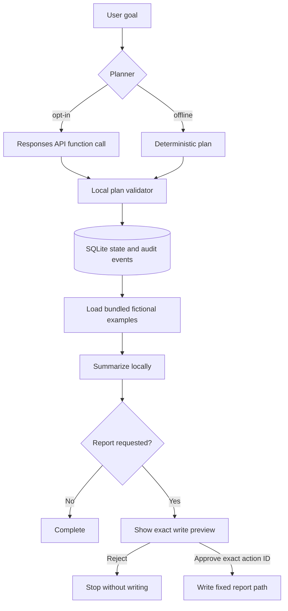

# Architecture and Safety Invariants

## Components

| Component | Responsibility | Trust boundary |
|---|---|---|
| `cli.py` | Selects the planner, obtains model-request confirmation, displays pending writes, and accepts a separate approval command. | User-controlled goals and command arguments are untrusted. |
| `planner.py` | Provides the offline demonstration plan or requests a bounded plan using one forced Responses API function call. | Model output is untrusted until it passes local validation. |
| `engine.py` | Persists the validated plan, resolves references to completed steps, runs queued allowlisted tools, and pauses for approval. | Unknown tools fail closed. |
| `tools.py` | Loads only bundled sample data, computes a summary, and writes one fixed Markdown report. | The writer accepts no arbitrary destination and refuses overwrite. |
| `store.py` | Records runs, action states, results, approvals, and audit events in SQLite. | Local state is not encrypted and is intended for one operator. |

## Workflow

## Invariants

1. The only model-callable function is `submit_workflow_plan`; the model cannot call the local tools directly.
2. Local validation allows exactly `load_sample_opportunities` followed by `summarize_opportunities`, optionally followed by `write_summary`.
3. The model supplies step names and a predecessor ID only. The application constructs all tool arguments and fixes the report destination.
4. `write_summary` is marked approval-required by the application, not by the model. The CLI displays the resolved content and destination before accepting the exact word `approve`.
5. Model planning is opt-in, interactive, and sends the goal, fixed planner instructions, and tool schema. Sample records and API credentials are not included in the model input.
6. The writer refuses paths outside `reports/`, symlinked report directories, and existing report files.
7. Exceptions are recorded by type, not by copying arbitrary exception text into the audit log.

## Data handling

Offline mode makes no network request. The optional Responses API call sets `store=False`; this request option is not equivalent to a Zero Data Retention guarantee. Provider policies can change. The SQLite database stores the goal and workflow results without application-level encryption. Do not submit credentials, personal records, client data, or other sensitive material.

## Deliberate scope

The workflow uses synthetic examples to demonstrate planning, dependency resolution, state persistence, and approval-gated effects. It is not a marketplace scraper, job recommender, or production service. It does not browse the web, send messages, modify remote systems, execute shell commands, or train a model.
